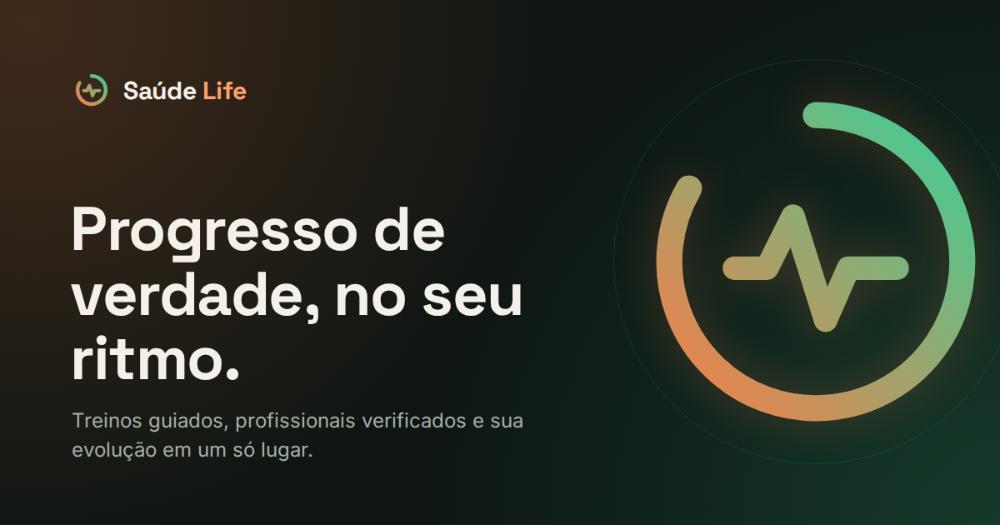

# Saúde Life

Site e app de fitness feito como TCC (MVP). Treinos guiados, registro de séries e cargas, evolução, alimentação e dois tipos de acesso: **cliente** (quem treina) e **administrador** (academia ou personal).

- **Front-end:** app React 18 + React Router + Vite (pasta `frontend/`): um `index.html` só, e o React Router troca as telas
- **Back-end e banco:** em refazimento (a versão antiga foi retirada; fica no histórico do git)



## Ver online

**https://chagaspq.github.io/saude-life/** (leva para o app em https://chagaspq.github.io/saude-life/docs/)

O GitHub Pages publica a raiz do repositório (**Settings > Pages > Deploy from a branch > `main` / `/ (root)`**).
O `index.html` da raiz leva para a pasta `docs/`, que é o site pronto (gerado a partir do `frontend/`).
O `404.html` da raiz é uma cópia do app: faz qualquer endereço do app (ex.: `/saude-life/docs/app/inicio`) abrir certo.

## Organização das pastas

```
saude-life/
├── frontend/          SITE (React + Vite): tudo o que aparece na tela
│   ├── index.html     a única página HTML: o React desenha tudo dentro dela
│   ├── src/
│   │   ├── main.jsx       começo do app (tema salvo, roteador, efeitos, tradução e Libras)
│   │   ├── rotas.jsx      rotas do React Router: cada endereço mostra uma tela
│   │   ├── paginas/       uma tela por arquivo (login.jsx, inicio.jsx, treino.jsx, admin.jsx...)
│   │   ├── componentes/   componentes React: Tela, casco do app, janelas, formulários, Efeitos (confete), Traducao, VLibras
│   │   ├── lib/           funções e dados: navegar.js, campos.js (ref), conta.js, pontos.js, exercicios.js, alimentos.js, idioma.js...
│   │   ├── estilos/       CSS (cores, base, site, app e um arquivo por tela)
│   │   └── config.js      endereço da API
│   ├── public/        ícones e imagem de compartilhar
│   ├── .env.development / .env.production   endereço da API no computador / no ar
│   ├── package.json   dependências (React, React Router, Vite)
│   └── vite.config.js configuração do Vite
│
├── docs/              SITE PRONTO (gerado pelo build do frontend; não editar à mão)
├── apresentacao/      vídeo da apresentação, falas e os scripts que geraram o vídeo
├── ROTEIRO-APRESENTACAO.md
└── index.html         leva da raiz do repositório para o site pronto
```

## Rodar o front-end (site)

Precisa do [Node.js](https://nodejs.org) 18 ou mais novo.

```bash
cd frontend
npm install        # instala o React e o Vite (só na primeira vez)
npm run dev        # abre o site em http://localhost:5173 e atualiza sozinho
npm run build      # gera o site pronto na pasta docs/ da raiz (é ela que vai para o ar)
```

Depois de mudar qualquer arquivo em `frontend/`, rode `npm run build` e mande a pasta `docs/` junto no commit.
Para ver o site pronto no computador antes de mandar: `npm run preview` (abre em http://localhost:4173/saude-life/docs/).

## Telas e endereços (React Router)

| Endereço | Tela |
|---|---|
| `/` | Boas-vindas |
| `/planos`, `/blog`, `/academias`, `/ajuda`, `/glossario`, `/calculadoras`, `/termos`, `/politica` | Site público |
| `/login`, `/cadastro`, `/senha`, `/senha/redefinir?token=` | Conta |
| `/app/inicio`, `/app/treinos`, `/app/treino?id=`, `/app/alimentacao`, `/app/evolucao`, `/app/perfil`, `/app/planos`, `/app/comecar` | App do cliente |
| `/app/admin` | Painel do administrador |
| qualquer outro | Página não encontrada (404) |

As rotas ficam em `frontend/src/rotas.jsx`. Cada tela só carrega quando a pessoa abre (e traz o próprio CSS, que sai quando ela fecha: `componentes/Tela.jsx`). A troca de tela é feita pelo `<Link>` do React Router, sem recarregar a página. O `AppLayout.jsx` (função `destino`) decide quem pode abrir cada tela do app.

## Back-end

O back-end e o banco de dados antigos foram retirados para serem refeitos. A versão antiga continua no histórico do git.

## Como testar rápido

Na tela **Entrar**:
- **Demonstração: cliente** entra com treinos de exemplo.
- **Demonstração: administrador** entra no Painel do administrador.
- **Apagar tudo deste navegador** zera tudo para começar do zero.

## O que tem

**Site público:** boas-vindas, planos, blog, para academias, ajuda, glossário, calculadoras, termos, política de privacidade e 404.
**Conta:** entrar, criar conta (cliente ou administrador), recuperar e redefinir senha.

**Cliente (5 telas):** Início, Treinos (e a tela do treino), Alimentação, Evolução e Perfil. Mais o questionário inicial e os planos.
**Administrador (2 telas):** Painel (clientes, mandar treino, avisos) e Perfil. Selo **ADMIN** verde no topo e faixa verde.

## Onde os dados ficam

Hoje, sem o back-end, o site salva só no navegador (modo demonstração). Quando o novo back-end ficar pronto, os dados passam a ir para o banco de dados.

## Acessibilidade

Botão de exibição em todas as telas: tema claro/escuro, tamanho da letra, alto contraste, menos movimento e idioma (português, inglês e espanhol). Respeita "reduzir movimento" do sistema, funciona no teclado e no celular.
